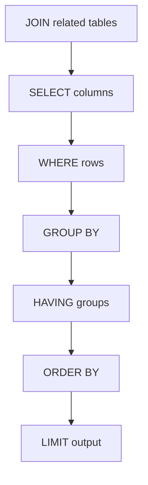

<h1>🔎 MYSQL QUERY FIELD GUIDE</h1>
ASSIGNMENT 02 · RETRIEVE, FILTER, GROUP & JOIN

## Query syntax map
| RETRIEVE | FILTER | SUMMARISE | COMBINE |
|---|---|---|---|
| `SELECT` | `WHERE` | `GROUP BY` | `INNER JOIN` |
| `DISTINCT` | `AND` | `HAVING` | `LEFT JOIN` |
| aliases | `IS NULL` | `SUM / AVG` | `RIGHT JOIN` |
| `ORDER BY` | `LIMIT` | `MIN / MAX` | `UPDATE` |

## SQL execution order — practical workflow

## Open the query workbook

The script sets up sample employee, department and location tables before query exercises.

> [!CAUTION]
> The script drops and recreates the employee database and clears tables. Use a disposable practice database only; existing target data can be lost.

## Recommended lab cycle
`READ → IDENTIFY DESTRUCTIVE SQL → SET UP SANDBOX → RUN → CHECK RESULT SET`

Synthetic employee data is used for learning relational queries, not real workforce reporting.